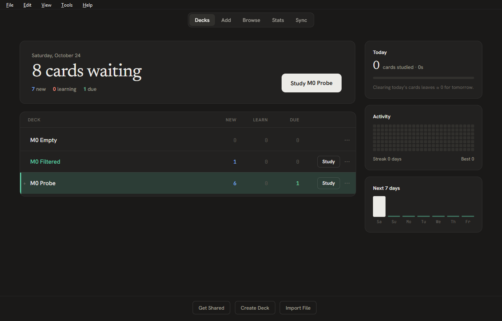
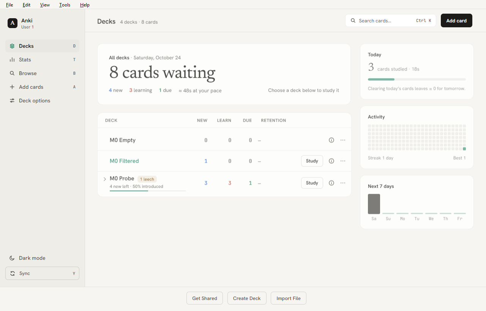
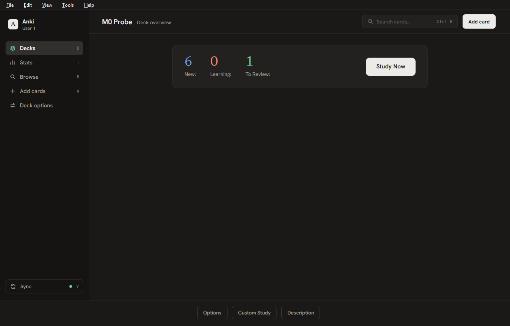
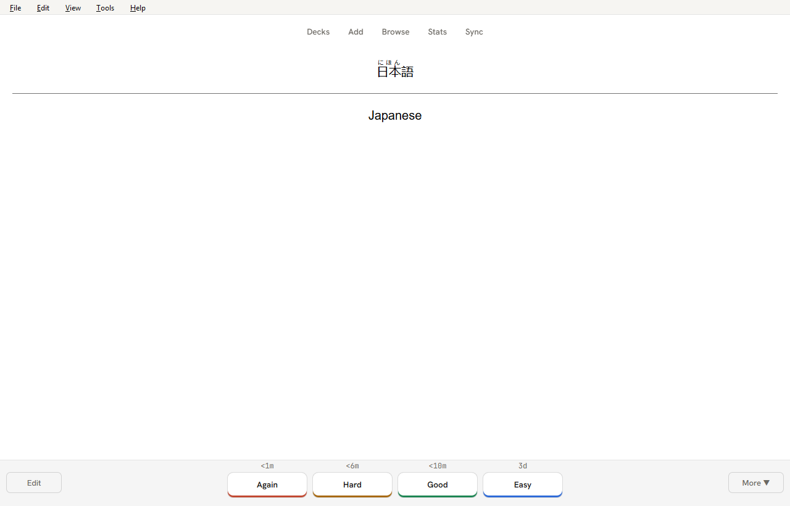
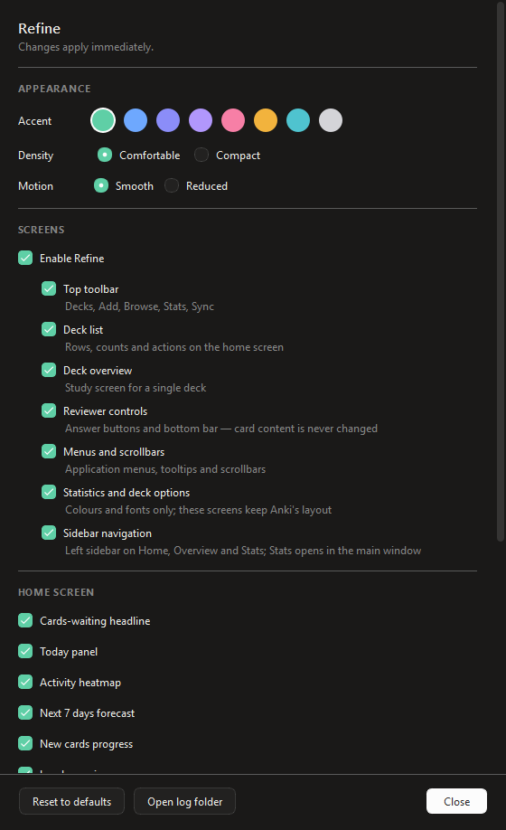

# Refine

Refine is an add-on for Anki Desktop that gives the home screen, deck overview, toolbar, reviewer answer bar and menus a cleaner, more modern look. It never changes your card templates, your scheduling or your data. Everything it shows is read from Anki's own data, and nothing is written to your collection.



| Light home screen | Deck overview |
|---|---|
|  |  |
| **Answer bar** (card content untouched) | **Settings** |
|  |  |

## Features

- **Home screen panels** (each can be turned off):
  - **Cards waiting** headline with the new / learning / due counts, an estimate of the time needed at your recent pace, and a **Study** button for the deck that has cards due.
  - **Today**: cards studied and time spent, with a progress bar and a note about what is left for tomorrow.
  - **Activity**: a 26-week heatmap of reviews per day, with your current and best streak.
  - **Next 7 days**: a forecast of cards due each day.
- **Sidebar navigation** like the design: Decks, Stats, Browse, Add cards, Deck options and Sync on the left, with a search and Add card header. **Statistics opens inside the main window** instead of a separate one. Can be turned off in Settings.
- A **Study** button on every deck row with cards waiting, and a welcome with next steps when the collection is still empty.
- Restyled **deck list**, **deck overview**, **top toolbar**, **reviewer answer bar** (tinted answer buttons with the interval inside; by default only Again and Good are shown, optional ease colours), the card **browser**'s table and sidebar, and Qt menus and scrollbars.
- **Optional, off by default: Japanese reading polish** for card content: a proper Japanese font for text your note type marks as Japanese (`lang="ja"`), tidier furigana, and furigana shown only on hover or on the answer side. Your note type's own styling always takes precedence.
- Light and dark themes follow Anki's own theme setting. Eight accent colours and two densities (comfortable, compact).
- Each screen can be switched off on its own, or all at once with the master switch.
- If one screen fails, Refine turns just that screen off, writes the error to its log and leaves Anki working normally.

## Compatibility

- Anki Desktop **25.09 to 26.09.3**. Other versions are blocked by the manifest or untested.
- Tested on Windows. macOS and Linux are untested; the add-on uses only Anki's public hooks and should work, but no promises.
- Other add-ons that restyle the same screens may conflict. See Troubleshooting.

## Install

1. Download `refine-<version>.ankiaddon`.
2. In Anki: **Tools ▸ Add-ons ▸ Install from file…** and pick the file.
3. Restart Anki.

## Settings

Open **Tools ▸ Refine ▸ Settings…** to choose the accent colour and density, switch screens and home panels on or off, and reset to defaults. Advanced users can edit the same values under **Tools ▸ Add-ons ▸ Refine ▸ Config**; every key is described there.

## Troubleshooting

- **See what Refine is doing:** **Tools ▸ Refine ▸ Diagnostics…** shows the Anki version, which screens are active and any screens Refine turned off after an error.
- **Log file:** `<add-on folder>/user_files/logs/refine.log` (open **Tools ▸ Add-ons**, select Refine, **View Files**). Include it when reporting a problem.
- **A screen looks wrong:** turn that screen off in Settings. Reviewing keeps working with the stock look.
- **Anki will not start normally:** hold **Shift** while Anki starts to run with all add-ons disabled, then disable or delete Refine in **Tools ▸ Add-ons**.
- **Conflict with another add-on:** disable the other add-on (or Refine) and restart to see which one is responsible.

## Rollback and uninstall

- **Quick:** turn off the master switch in Settings, or untick Refine in **Tools ▸ Add-ons**, then restart Anki.
- **Remove:** select Refine in **Tools ▸ Add-ons** and choose **Delete**. Refine stores nothing in your collection, so decks, cards, scheduling and sync are unaffected and there is nothing to clean up.
- **Older version:** install the earlier `.ankiaddon` file over the current one.

## Privacy

Refine makes no network requests and sends no data anywhere. Settings live in Anki's add-on config and the log stays on your computer.

## License

Bundled fonts (Hanken Grotesk, JetBrains Mono, Newsreader) are under the SIL Open Font License; copies are in `src/refine/LICENSES/`.

## Development

Design and plan: [PLAN.md](PLAN.md). Milestone 0 verification: [docs/M0-REPORT.md](docs/M0-REPORT.md). Change history: [CHANGELOG.md](CHANGELOG.md).

### Setup (Windows; macOS/Linux use the same commands)

Requirements: Python 3.10–3.13 on PATH (`py`), Git. An installed Anki is optional.

```sh
py scripts/devenv.py venvs          # PyPI builds of Anki 25.09.5 and 26.09.3 in .venv/
py scripts/devenv.py targets        # shows which Anki builds were found
```

### Run a dev Anki

```sh
py scripts/devenv.py run 26.09.3-installed --port 8080
```

- Uses an isolated base folder `.anki-dev/<target>/`. Your normal profile is never opened, and a running Anki is left alone.
- `addons21/refine` is a junction/symlink to `src/refine`. Edit, then restart Anki.
- Webview DevTools: open `http://127.0.0.1:8080` in Chrome or Edge.
- Targets: `26.09.3-installed` (official installer), `26.09.3-pypi`, `25.09.5-pypi`.

### Snapshots and contract tests

```sh
py scripts/devenv.py snapshot --all              # drives each Anki build, captures HTML, writes docs/M0-RESULTS.md
py -m unittest discover -s tests -t .            # selector contract + unit tests (no Anki needed)
```

`snapshot` seeds a throwaway collection in `.anki-dev/<target>/`. It deletes and recreates that folder on every run. Never point it at real data. The probe refuses to run outside `.anki-dev`.

### Screenshots

```sh
py scripts/devenv.py shots 26.09.3-installed      # add --keep-profile to reuse .anki-dev/<target>
```

Launches an isolated Anki with the dev-only `refine_ui_probe` add-on, which seeds the throwaway collection and writes full-window PNGs (`light_`/`dark_` + `deck_browser`, `deck_browser_narrow`, `overview`, `reviewer_question`, `reviewer_answer`, `settings`) plus `shots.json` and `anki-console.log` to `out/ui/<target>/` (git-ignored). The settings shot is skipped if the add-on exposes no `_ctx`.

### Build a release file

```sh
py scripts/build.py            # writes dist/refine-<version>.ankiaddon and validates it
py scripts/build.py --check    # only re-validates the existing file
```

The archive holds the contents of `src/refine/` (no top-level folder, no `__pycache__`, no `meta.json`, nothing from `user_files/` except its `README.txt`). The same input always produces the same bytes. The version comes from `src/refine/manifest.json`; add a matching entry to [CHANGELOG.md](CHANGELOG.md).

### Layout

| Path | What |
|---|---|
| `src/refine/` | The add-on (this is what gets packaged) |
| `devtools/m0_probe/` | Dev-only probe add-on; inert unless `REFINE_M0_OUT` is set; never shipped |
| `devtools/ui_probe/` | Dev-only screenshot add-on; inert unless `REFINE_UI_OUT` is set; never shipped |
| `devtools/htmlinventory.py` | Stdlib HTML/selector helpers used by the report and tests |
| `scripts/build.py` | Builds `dist/refine-<version>.ankiaddon` |
| `scripts/devenv.py` | venvs, isolated profiles, linking, launching, snapshots, report |
| `tests/contract/fixtures/<target>/` | Captured HTML + probe/DevTools data per Anki build |

### Troubleshooting (development)

- **Anki shows a language dialog / hangs on first start:** the profile wasn't pre-seeded. Run `py scripts/devenv.py setup <target> --fresh`.
- **Nothing happens on launch:** another dev instance of the same target is still open. Close it.
- **Rollback:** delete `.anki-dev/`. Nothing outside the repository is modified.
